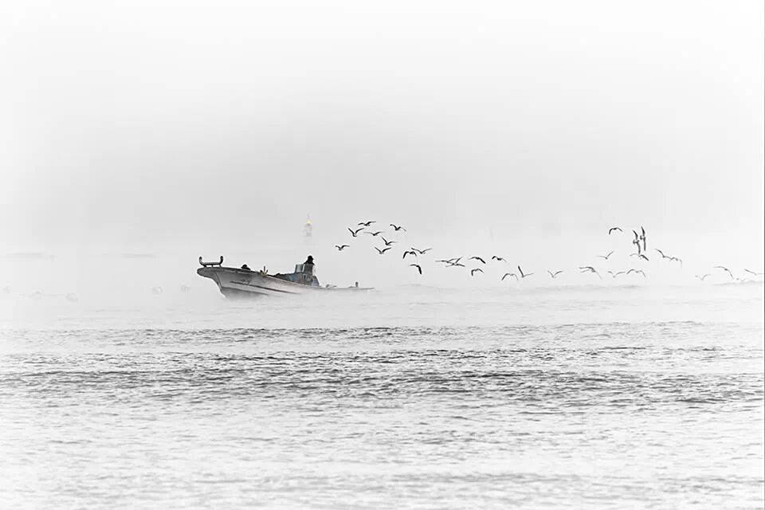
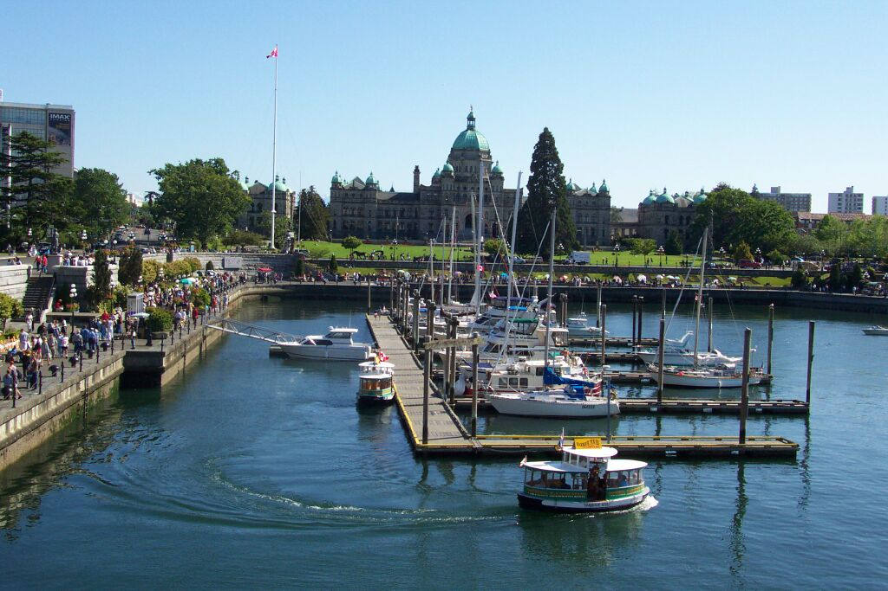

 ## Quiz-1 

[Quiz]: 다음 이미지에 대한 설명 중 옳지 않은 것은 무엇인가요?

- (1) 한 척의 보트가 물 위에 떠 있습니다.
- (2) 보트 주변으로 여러 마리의 새들이 날고 있습니다.
- (3) 보트는 강 위에서 움직이고 있습니다.
- (4) 안개가 자욱하게 깔려 있습니다.

Listening: Which of the following descriptions of the image is incorrect?

- (1) A boat is floating on the water.
- (2) Several birds are flying around the boat.
- (3) The boat is moving on a river.
- (4) There is a heavy fog.

[Answer]: (3) 보트는 강이 아닌 바다 위에서 움직이고 있습니다.

---------------------

 ## Quiz-2 

[Quiz]: 다음 이미지에 대한 설명 중 옳지 않은 것은 무엇인가요?

- (1) 호수가 있는 항구에 몇몇 보트가 정박해 있습니다.
- (2) 항구 주변에 많은 사람들이 걸어 다니고 있습니다.
- (3) 건물 위에 빨간색 깃발이 걸려 있습니다.
- (4) 배경에 높은 산이 보입니다.

Listening: Which of the following descriptions of the image is incorrect?

- (1) There are several boats docked in a harbor with a lake.
- (2) Many people are walking around the harbor area.
- (3) A red flag is visible atop a building.
- (4) There are tall mountains in the background.

[Answer]: (4) 배경에 높은 산은 보이지 않고, 건물들이 있습니다.

---------------------

