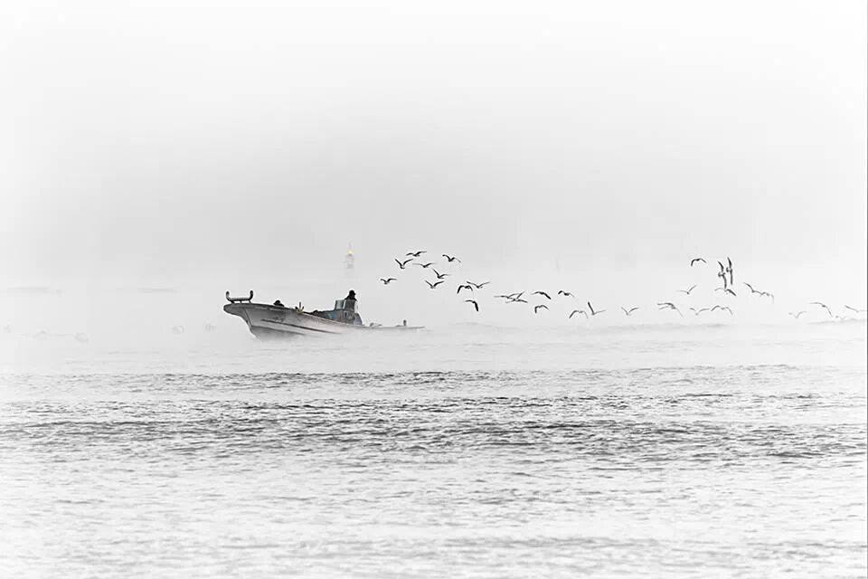
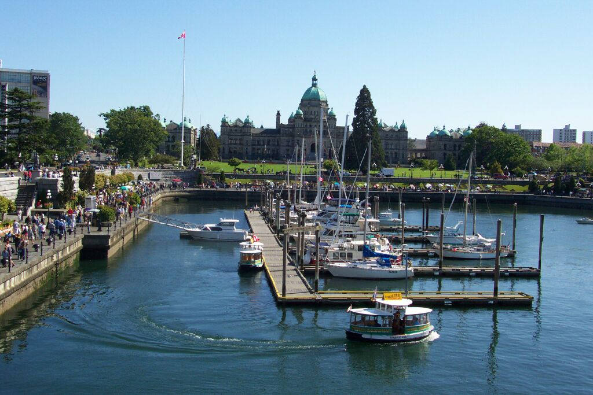

 ## Quiz-1 

        [Quiz]: 다음 이미지에 대한 설명 중 옳지 않은 것은 무엇인가요?
        - (1) 바다 위에 한 척의 배가 떠 있습니다.
        - (2) 배의 가까운 곳에 많은 새들이 날고 있습니다.
        - (3) 해변가에서 사람들이 수영을 하고 있습니다.
        - (4) 이미지는 안개가 짙게 낀 풍경을 보여줍니다.

        Listening: Which of the following descriptions of the image is incorrect?
        - (1) A boat is floating on the sea.
        - (2) Many birds are flying near the boat.
        - (3) People are swimming at the beach.
        - (4) The image shows a foggy landscape.

        [Answer]: (3) 해변가에서 사람들이 수영을 하고 있는 모습은 보이지 않습니다.

---------------------

 ## Quiz-2 

[Quiz]: 다음 이미지에 대한 설명 중 옳지 않은 것은 무엇인가요?
- (1) 여러 대의 보트가 정박해 있는 모습을 볼 수 있습니다.
- (2) 많은 사람들이 공원에서 산책을 하고 있습니다.
- (3) 건물 위에 캐나다 국기가 휘날리고 있습니다.
- (4) 물 위에는 빨간색 보트가 하나 떠 있습니다.

Listening: Which of the following descriptions of the image is incorrect?
- (1) You can see several boats docked at the harbor.
- (2) Many people are walking in the park.
- (3) The Canadian flag is flying above a building.
- (4) There is a red boat floating on the water.

[Answer]: (4) 물 위에는 빨간색 보트가 아닌 다른 색 보트가 떠 있습니다.

---------------------

